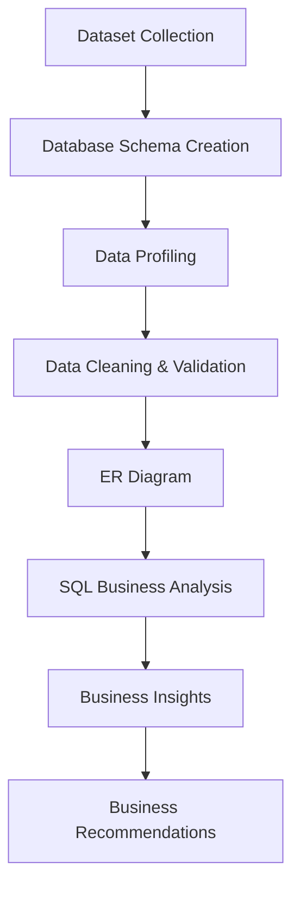

# 🏦 Banking Analytics | SQL Project

An end-to-end banking analytics project using SQL and PostgreSQL to analyze customer profiles, account activity, transaction patterns, loan performance, and branch operations.

<p align="left">
  
</p>

---

## 📑 Table of Contents

1. [Project Overview](#-project-overview)
2. [Business Problem](#-business-problem)
3. [Business Questions](#-business-questions)
4. [Dataset Description](#-dataset-description)
5. [Tools & Technologies](#-tools--technologies)
6. [Project Workflow](#-project-workflow)
7. [Data Profiling, Cleaning & Validation](#-data-profiling-cleaning--validation)
8. [Database Schema & ER Diagram](#-database-schema--er-diagram)
9. [SQL Analysis](#-sql-analysis)
10. [Key Insights](#-key-insights)
11. [Business Recommendations](#-business-recommendations)
12. [Project Documentation](#-project-documentation)
13. [Conclusion](#-conclusion)
14. [Repository Structure](#-repository-structure)

---

## 📌 Project Overview

This project focuses on analyzing banking operations using SQL and PostgreSQL. It explores customer information, account details, transaction activities, loan performance, and branch operations through multiple related database tables.

The project demonstrates relational database design, data profiling, data cleaning, validation, and business-focused SQL analysis to derive meaningful insights from banking data.

## 🎯 Business Problem

Banks manage large volumes of customer, account, transaction, and loan data. Analyzing these datasets independently makes it difficult to understand customer relationships, identify transaction patterns, evaluate loan performance, and assess operational activities.

This project uses relational database design and SQL analysis to connect different banking datasets and investigate customer behavior, account distribution, transaction trends, loan status, and branch-level performance.

## ❓ Business Questions

- How are customers distributed across different customer segments?
- What is the distribution of accounts across account types and account statuses?
- What patterns can be identified in deposits, withdrawals, transfers, and other transaction activities?
- Which customers and account categories contribute the highest transaction activity?
- How are loans distributed across different loan types and loan statuses?
- Which branches show higher transaction activity and customer engagement?
- What patterns can be identified in overdue loans and account balances?

## 📂 Dataset Description

**Source:** [Finance, Fraud and Loans Dataset – Kaggle](https://www.kaggle.com/)

The dataset represents a banking system containing customer, account, transaction, loan, branch, and reference information organized across multiple related tables.

📁 **Explore the complete dataset description and table details:** [Dataset README](data/README.md)

## 🛠️ Tools & Technologies

| Tool | Purpose |
|---|---|
| PostgreSQL | Relational database management and execution of analytical SQL queries |

## 🔄 Project Workflow

The project follows a structured SQL analytics workflow, from database preparation and data quality assessment to relational analysis and business recommendations.



## 🧹 Data Profiling, Cleaning & Validation

Data profiling, cleaning, and validation were performed to assess data quality and ensure consistency across the banking tables before conducting business analysis.

Key activities included:

- Examining table structures, columns, and data types.
- Identifying missing values and duplicate records.
- Checking primary key and foreign key relationships.
- Validating referential integrity across related tables.
- Investigating data inconsistencies and anomalies.
- Performing necessary data cleaning and validation checks.

📄 **Detailed documentation:** [Data Profiling, Cleaning & Validation Report](documentation/data_profiling_cleaning_validation_report.md)

📁 **SQL queries:** [02 – Data Profiling, Cleaning & Validation](sql/02_data_profiling_cleaning_validation.sql)

## 🗺️ Database Schema & ER Diagram

After completing data profiling, cleaning, and validation, the Entity Relationship (ER) Diagram was prepared to represent the structure and relationships of the banking database.

It illustrates how the core banking tables and supporting reference tables are connected, providing a clear understanding of the relational database structure before performing business analysis.

**Database Schema**
[Schema](sql/01_database_schema.sql)

**ER Diagram Preview**


## 🗄️ SQL Analysis

With the database structure and relationships established, SQL queries were developed to perform business-focused analysis across the banking datasets.

The analysis covers:

- **Customer Analysis:** Customer distribution and segmentation.
- **Account Analysis:** Account types, account statuses, and account balances.
- **Transaction Analysis:** Transaction volumes, amounts, and transaction categories.
- **Loan Analysis:** Loan distribution, principal amounts, interest rates, and loan statuses.
- **Branch Analysis:** Branch-level customer and transaction activity.
- **Relational Analysis:** Combining multiple tables using joins, aggregations, subqueries, and other SQL techniques.

📁 **Explore the complete SQL analysis:**

- [01 – Business Analysis](sql/03_business_analysis.sql)

## 💡 Key Insights

The SQL analysis focuses on identifying meaningful findings across the following banking areas:

- **Customer Segmentation:** Understand customer distribution across different customer categories.
- **Account Activity:** Evaluate account distribution across account types and lifecycle statuses.
- **Transaction Behavior:** Identify patterns in deposits, withdrawals, transfers, and payments.
- **Loan Performance:** Examine loan distribution and repayment-related statuses.
- **Branch Operations:** Compare banking activity across different branches.

📄 **Explore detailed findings:** [Business Insights](documentation/business_insights.md)

## 🚀 Business Recommendations

The findings from the SQL analysis are translated into actionable recommendations to support better banking operations.

Key areas for improvement include:

- **Customer Engagement:** Develop targeted banking services for different customer segments.
- **Account Management:** Monitor inactive and closed accounts to better understand account lifecycle patterns.
- **Transaction Monitoring:** Track transaction activity and unusual patterns to strengthen monitoring.
- **Loan Management:** Monitor overdue loans and strengthen repayment follow-up strategies.
- **Branch Performance:** Use branch-level activity to identify opportunities for improving operational efficiency.

📄 **Explore detailed recommendations:** [Business Recommendations](documentation/recommendations.md)

## 🏁 Conclusion

This project demonstrates the application of SQL and PostgreSQL in analyzing banking operations through relational database design, data quality assessment, and multi-table business analysis.

By examining customer profiles, accounts, transactions, loans, and branch activities, the project transforms structured banking data into meaningful business insights and actionable recommendations.

It highlights practical SQL skills in database schema creation, data profiling, cleaning, validation, relational querying, and business analysis.

## 📁 Repository Structure

```text
banking-analytics-sql/
│
├── data/
│   └── README.md
│
├── documentation/
│   ├── business_insights.md
│   ├── data_profiling_cleaning_validation_report.md
│   └── recommendations.md
│
├── images/
│   └── ER Diagram.png
│
├── sql/
│   ├── 01_database_schema.sql
│   ├── 02_data_profiling_cleaning_validation.sql
│   └── 03_business_analysis.sql
│
└── README.md
```

---

**👩‍💻 Author:** Riya Gupta

**🔗 GitHub:** [riyagupta557](https://github.com/riyagupta557)

**💼 LinkedIn:** Add your LinkedIn profile link here.
